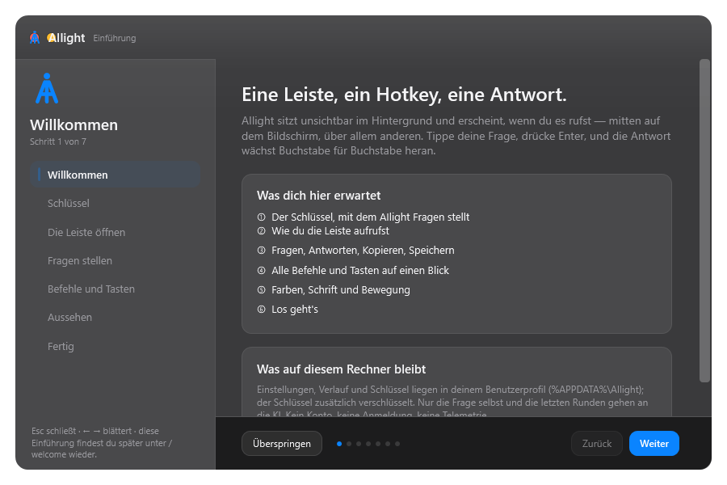
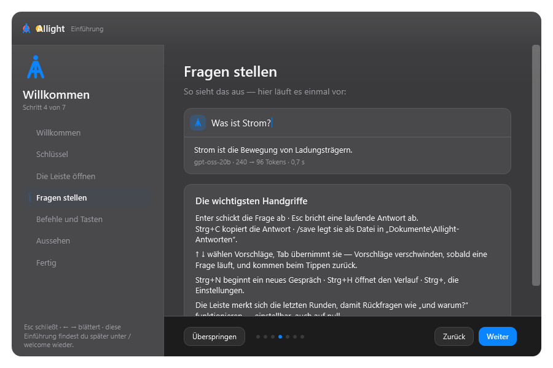

# AIlight

<p align="center">
  
</p>

<p align="center">
  <strong>KI-Leiste für Windows — Hotkey drücken, Frage tippen, gestreamte Antwort bekommen.</strong>
</p>

<p align="center">
  <a href="https://github.com/rian2acc/AiLight/releases/latest"></a>
  <a href="https://github.com/rian2acc/AiLight/releases/latest"></a>
  <a href="https://github.com/rian2acc/AiLight/blob/main/LICENSE"></a>
  <a href="https://dotnet.microsoft.com/download/dotnet/8.0"></a>
  <a href="https://github.com/rian2acc/AiLight/actions"></a>
</p>

---

> **Das Logo** ist ein leuchtender Punkt, aus dem drei Strahlen nach unten gehen — die
> beiden äußeren bilden mit dem Querstrich dazwischen ein **A**, der mittlere Strahl ist das
> **I**. So steckt der Name als ein einziges Bild in der Marke, bewusst kein vierstrahliges
> „KI-Funkeln“. Dieselbe Form sitzt als Vektorgrafik in der Leiste, im Einstellungsfenster
> und im Programmsymbol (`tools/make_icon.py` erzeugt es reproduzierbar aus einem Raster).

## ✨ Funktionen

| Funktion | Beschreibung |
|----------|--------------|
| **Globaler Hotkey** | `Alt+Space` (frei wählbar) — sofort da, aus jedem Programm |
| **Streaming-Antworten** | Der Text erscheint Wort für Wort über die Groq-API |
| **Smarte Vorschläge** | Frühere Fragen, Befehle, Zwischenablage — per Tastatur bedienbar |
| **Nur das Gespräch** | Wird eine Frage abgeschickt, klappen die Vorschläge weg: der Platz gehört der Antwort. Beim Tippen sind sie sofort wieder da |
| **Einführung beim ersten Start** | Sieben Schritte, die alles erklären — mit mitlaufender Vorführung; später jederzeit über `/welcome` |
| **Neue Marke** | Leuchtender Punkt oben, drei Strahlen nach unten — die äußeren ergeben mit dem Querstrich ein **A**, der mittlere ist das **I** |
| **macOS-Look** | Ruhige Flächen, Haarlinien, großzügige Ecken, ein Lichtschein von oben, Ampel-Knöpfe in den Einstellungen |
| **Überall weich** | Auftritt der Leiste, Seitenwechsel, Hover, Regler, Markierung, Antwortabsätze und Listenzeilen: alles blendet über statt umzuspringen |
| **Eine Kurve für alles** | Die steile Auslaufkurve von macOS (`cubic-bezier(0.32, 0.72, 0, 1)`), als eigene WPF-Kurve nachgerechnet und im Selbsttest geprüft — auch die Übergänge im Aufbau |
| **Vorschläge kommen gestaffelt** | Jede Zeile folgt der vorigen um 26 ms; die Antwort blendet Absatz für Absatz auf, statt mit einem Schlag dazustehen |
| **Nichts springt** | Vorschlagsliste und Antwort gleiten — bildsynchron (`CompositionTarget.Rendering`), damit es auf 60- und 144-Hz-Bildschirmen gleich aussieht |
| **Drei Punkte statt eines Blinkers** | Solange geantwortet wird, leuchten drei Punkte der Reihe nach auf |
| **Hört auf Windows** | Ist in Windows „Animationen“ abgeschaltet, bewegt sich auch AIlight nicht mehr — und in den Einstellungen lässt sich die Bewegung zusätzlich ausschalten |
| **Schwebt nie im Weg** | Öffnen die Einstellungen, zieht sich die Leiste zurück — und holt sich dabei keinen fremden Fokus |
| **Alles anpassbar** | Akzentfarbe (9 macOS-Töne), Ecken-Radius, Schrift, Breite/Höhe/Deckkraft, Bewegung, Fußzeile |
| **Gesprächsgedächtnis** | Einstellbare Runden, `/forget` löscht |
| **Verlauf & Statistik** | Tokens, Kostenschätzung, durchsuchbar, exportierbar |
| **Infobereich** | Nur eine Instanz, Autostart, kein Hintergrunddienst |
| **Selbsttest eingebaut** | `AIlight.exe --selftest` → **59 Prüfungen**, teils auf Pixel-Ebene |
| **Installer** | 49,4 MB (≈47 MiB) Inno-Setup-Bündel — inklusive .NET, ohne Administratorrechte, pro Benutzer |
| **Portable Fassung** | Dieselbe Version als `AIlightPortable.zip` — entpacken und starten, ohne Installer |
| **Prüfsummen** | `SHA256SUMS.txt` liegt bei jedem Release bei |

## 📥 Installation

### Variante A: Installer (empfohlen)

1. **`AIlightSetup.exe`** aus der [neuesten Fassung](https://github.com/rian2acc/AiLight/releases/latest) laden (49,4 MB)
2. Ausführen — installiert nach `%LOCALAPPDATA%\AIlight`, legt Startmenü-Eintrag und Autostart an
3. Die **Einführung** führt durch die sieben Schritte und fragt dabei nach dem Schlüssel
4. `Alt+Space` drücken und fragen

### Variante B: Portable (ohne Installer)

**`AIlightPortable.zip`** laden, entpacken, `AIlight.exe` starten. Kein
Installer, kein Eintrag, nichts, was sich einnistet — und ein Weg, der bei
Virenschutz-Programmen grundsätzlich weniger Fragen aufwirft.

### Variante C: Aus dem Quellcode bauen

```powershell
# Voraussetzungen: .NET 8 SDK, Inno Setup 6
git clone https://github.com/rian2acc/AiLight.git
cd AiLight
powershell -ExecutionPolicy Bypass -File tools\build.ps1
# Ergebnis: dist\installer\AIlightSetup.exe, AIlightPortable.zip, SHA256SUMS.txt
```

> Das Skript läuft den 59-Punkte-Selbsttest, veröffentlicht eine self-contained
> EXE-Mappe (kein .NET nötig), packt den Installer, schreibt die Portable-Fassung
> und die Prüfsummen. Schalter: `-SkipTest`, `-SkipInstaller`, `-Sign`
> (signieren, siehe unten), `-Uncompressed`.


## 🛡️ Wenn Windows oder der Virenschutz meckert

Der Installer ist **nicht signiert**. Manche Scanner stufen eine unbekannte,
frisch gebaute Setup-Datei deshalb als verdächtig ein — das ist eine Heuristik,
kein Befund. Drei Dinge helfen, ausführlich in
[**docs/signieren.md**](docs/signieren.md):

1. **Prüfsumme vergleichen** — `SHA256SUMS.txt` liegt bei jedem Release bei:
   `Get-FileHash .\AIlightSetup.exe -Algorithm SHA256`
2. **Portable Fassung nehmen** — `AIlightPortable.zip` entpacken und `AIlight.exe` starten
3. **Fehlalarm melden** — Microsoft und McAfee haben dafür Formulare; solche
   Meldungen werden analysiert und meist innerhalb von Tagen korrigiert

> Bitte **nicht** den Virenschutz abschalten oder eine Ausnahme einrichten. Das
> behebt nichts, sondern öffnet eine Tür.

## ⌨️ Kurzübersicht

| Taste | Wirkung |
|-------|---------|
| `Alt+Space` | Leiste zeigen/verstecken (frei wählbar) |
| `Enter` | Frage senden / markierten Vorschlag ausführen |
| `Esc` | Anfrage abbrechen, dann Leiste schließen |
| `↑` `↓` / `Bild↑` `Bild↓` | Vorschläge durchblättern |
| `Tab` | Eingabe mit dem markierten Vorschlag füllen |
| `Strg+↑` / `Strg+↓` | Frühere Fragen durchblättern |
| `Strg+C` | Letzte Antwort kopieren (im Eingabefeld: normales Kopieren) |
| `Strg+N` | Neues Gespräch (Gedächtnis leeren) |
| `Strg+H` | Verlauf öffnen |
| `Strg+,` | Einstellungen öffnen |

> Solange das Einstellungsfenster offen ist, hält sich die Leiste zurück: Sie
> verschwindet beim Öffnen und der Hotkey holt das Einstellungsfenster nach vorn,
> statt die Leiste darüber zu legen.

**Befehle** (im leeren Eingabefeld `/` tippen):

| Befehl | Wirkung |
|--------|---------|
| `/new` | Frisches Gespräch beginnen |
| `/clip` | Über den Inhalt der Zwischenablage fragen |
| `/history [Begriff]` | Verlauf durchsuchen und öffnen |
| `/forget [Begriff]` | Verlauf löschen (ohne Begriff: alles) |
| `/stats` | Anzahl, Tokens, geschätzte Kosten |
| `/model [auto\|20b\|120b]` | Modell wechseln |
| `/prompt` | System-Prompt ansehen |
| `/conversation` | Zeigen, was an die API geht |
| `/copy` | Letzte Antwort in die Zwischenablage |
| `/save` | Letzte Antwort als `.md` speichern |
| `/settings` | Einstellungen öffnen |
| `/welcome` | Die Einführung erneut anzeigen |
| `/help` | Alle Befehle auflisten |
| `/quit` | AIlight beenden |

## 🎛️ Mach es zu deinem

Das ganze Aussehen ist einstellbar — jede Änderung wirkt sofort, ohne Neustart:

| Einstellung | Möglichkeiten |
|-------------|----------------|
| Akzentfarbe | 9 macOS-Töne: Blau, Türkis, Grün, Gelb, Orange, Rot, Pink, Lila, Graphit |
| Ecken-Radius | 8–22 — Leiste, Karten, Felder und Zeilen skalieren gemeinsam |
| Schrift | System (Segoe UI Variable), Segoe UI, Calibri, Arial |
| Leiste | Breite 420–1200, Abstand von oben 0–40, Schriftgröße 12–28, Deckkraft 60–100 % |
| Bewegung | Auftritt und Abgang der Leiste, Überblenden der Seiten und Bedienelemente, Nachziehen des Textes, Impuls an/aus |
| Antwort | Denk-Schritte automatisch aufklappen, Fußzeile (Modell · Tokens · Kosten) ein/aus |
| Verhalten | Hotkey, Autostart, Vorbereiten im Hintergrund, Schließen bei Fokusverlust, Protokoll |

## 🖼️ Bilder

<p float="left">
  
  
</p>
<p float="left">
  
  
</p>

<p float="left">
  
  
</p>

*Weitere Bilder in [`docs/bilder/`](docs/bilder) — erzeugt von `AIlight.exe --shot docs\bilder`.*

## 🗂️ Wo die Daten liegen

| Daten | Ort |
|-------|-----|
| Einstellungen | `%APPDATA%\AIlight\settings.json` |
| Verlauf (JSONL) | `%APPDATA%\AIlight\history.jsonl` |
| Gesprächsgedächtnis | `%APPDATA%\AIlight\conversation.json` |
| Letzte Antwort | `%APPDATA%\AIlight\last_answer.md` |
| Gespeicherte Antworten | `%USERPROFILE%\Documents\AIlight-Antworten` |
| Protokoll (rollierend, 4 Dateien) | `%LOCALAPPDATA%\AIlight\logs\ailight.log` |
| API-Schlüssel | **Windows-Anmeldeinformationsspeicher** → `AIlight:groq-api-key` |

> Deinstallieren lässt Einstellungen, Verlauf und Schlüssel stehen. Neu installieren = sofort weiterarbeiten.

## 🛠️ Eingebaute Diagnose

```powershell
AIlight.exe --selftest           # 52 Prüfungen, Rückgabewert 0 = bestanden
AIlight.exe --smoke 4            # Leiste, Hotkey, Infobereich, Größe, Position
AIlight.exe --ask "Sag: ok"      # Frage ohne Fenster
AIlight.exe --ask-ui "2+2?"      # Simulierte Bedienung der Leiste
AIlight.exe --shot docs\bilder   # Alle Fenster als PNG zeichnen
AIlight.exe --show               # Leiste zeigen und offen halten (Esc schließt)
AIlight.exe --quit               # Laufende Instanz beenden
AIlight.exe --report out.txt     # Messläufe in eine Datei schreiben
```
Der Selbsttest zeichnet echte Fenster und prüft **echte Pixel** — zum Beispiel muss der
gefüllte Teil eines Reglers links in der Akzentfarbe stehen, eine markierte
Vorschlagszeile ihren Akzentstreifen an der erwarteten Stelle zeigen und die neue Marke
in der Leiste wirklich als A mit Lichtpunkt und Mittelstrahl ankommen. Auch die
Überblendungen werden nachgemessen: mitten im Wechsel muss die Deckkraft zwischen 0 und 1
liegen und am Ende genau 1 oder 0 sein — kein halb sichtbarer Rest.

## 🏗️ Aufbau

```
src/AIlight/
  Program.cs           Einstieg: Testmodi → Einzelinstanz → Start
  App.cs               Lebenszyklus, Hotkey, Infobereich, Fenster, Prüfmodi
  MainWindow.*         Die Leiste: Eingabe, Vorschläge, Streaming-Markdown
  SettingsWindow.*     Sieben Bereiche, Live-Vorschau, eigener Rahmen
  AppSettings.cs       Einstellungen laden/speichern (JSON)
  WelcomeWindow.*      Die Einführung: sieben Schritte mit Vorführung
  SelfTest.cs          59 Prüfungen, teils auf Pixel-Ebene
  Commands.cs          Register der Schrägstrich-Befehle
  Suggestions.cs       Vorschlagszeilen unter der Eingabe
  Core/                Hotkey, Einzelinstanz, Schlüsselspeicher, Protokoll, Symbole, Pfade, atomares Schreiben
  Groq/                HTTP-Client, Streaming, Modelle, Verlauf
  Views/               Markdown-Darstellung, Themen (hell/dunkel), Bewegung
                       (Motion/Curve/Anim/Glide), Bildschirmfotos
tools/                 build.ps1, make_icon.py, Messwerkzeuge
packaging/             ailight.iss (Inno Setup), ailight.ico
docs/bilder/           Bilder für dieses README
```

**Designentscheidungen:**

- **Ein Programm**, self-contained — kein Hintergrunddienst, kein Plugin-System
- **Vorbereitete Leiste** entsteht im Leerlauf → erster Hotkey in 6–40 ms
- **Direkt zur Groq-API** — kein Zwischenserver, keine Telemetrie
- **Selbsttest steckt in der EXE** — geprüft wird genau das, was Nutzer starten
- **Schlüssel im Anmeldeinformationsspeicher** — berührt nie die Festplatte
- **macOS-inspiriertes Designsystem** — eine Themendatei steuert Farben, Radien und Schrift; jedes Fenster folgt live
- **Eigene Marke**: Lichtpunkt mit drei Strahlen, in denen „AI“ steckt — aus einer einzigen Maßtabelle in Symbol, Vektorgrafik und Notfallzeichnung

## 📊 Messwerte (Release, dieser Rechner)

| Messgröße | Wert |
|-----------|------|
| Leiste erscheint (vorbereitet) | 6–40 ms |
| Leiste erscheint (kalt) | 0,5–0,8 s |
| Erstes Antwort-Token | 0,4–0,6 s |
| Leerlauf-CPU | 0 % |
| Leerlauf-RAM | ca. 90 MB |
| Installergröße | 49,4 MB (≈47 MiB, inklusive .NET 8) |
| Portable-Fassung | 61,3 MB ZIP (144,8 MB entpackt) |
| Installierte Größe | ca. 152 MB (145 MiB) Programmdateien, mit Deinstallierer 156 MB (149 MiB) |

## ⚠️ Bekannte Grenzen

- **Nur Groq** — ein Anbieter, kein Modell-Marktplatz
- **Nur Windows 10/11 x64**
- Konflikte beim Hotkey werden erkannt (Protokoll + Hinweis in der Oberfläche) 
- **Unsignierter Installer** → SmartScreen-Hinweis und gelegentlich ein Fehlalarm
  eines Virenschutz-Programms. Was dagegen hilft und wie man ihn meldet:
  [docs/signieren.md](docs/signieren.md). Bis dahin ist
  `AIlightPortable.zip` der ruhigere Weg
- Getestet auf dem Windows-10-Konto des Autors — nicht auf frischen virtuellen Maschinen
- Das Signieren ist vorbereitet, aber mangels Zertifikat noch nicht durchlaufen

## 🤝 Mitmachen

Fehlerberichte und Pull Requests sind willkommen. Besonders gebraucht:

- Ein Codesignatur-Zertifikat für die Releases (der Bau dafür steht bereit: `tools\build.ps1 -Sign`)
- Weitere KI-Anbieter (OpenAI, Anthropic, lokal über Ollama)
- Linux/macOS über Avalonia oder MAUI
- Weitere Einheitstests für Groq-Client und Verlaufsspeicher
- Übersetzungen (Oberfläche und Kommentare sind auf Deutsch)

```powershell
# Schnelle Entwicklungsrunde
powershell tools\build.ps1 -SkipInstaller
AIlight.exe --selftest
```

## 📄 Lizenz

[MIT](LICENSE) — mach damit, was du willst; behalte nur den Hinweis.

## 🙏 Danke

- [Groq](https://groq.com/) für die schnelle Inferenz-API
- [.NET](https://dotnet.microsoft.com/) für self-contained Publishing
- [Inno Setup](https://jrsoftware.org/isinfo.php) für den Installer
- [Pillow](https://python-pillow.org/) für die Logo-Erzeugung in `tools/make_icon.py`
