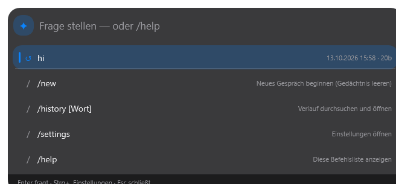
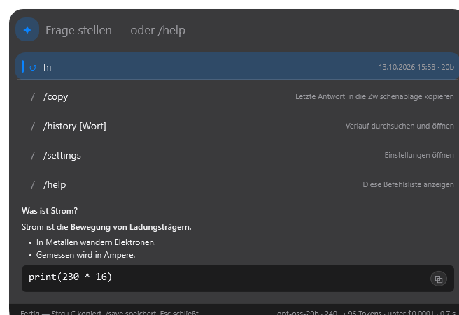
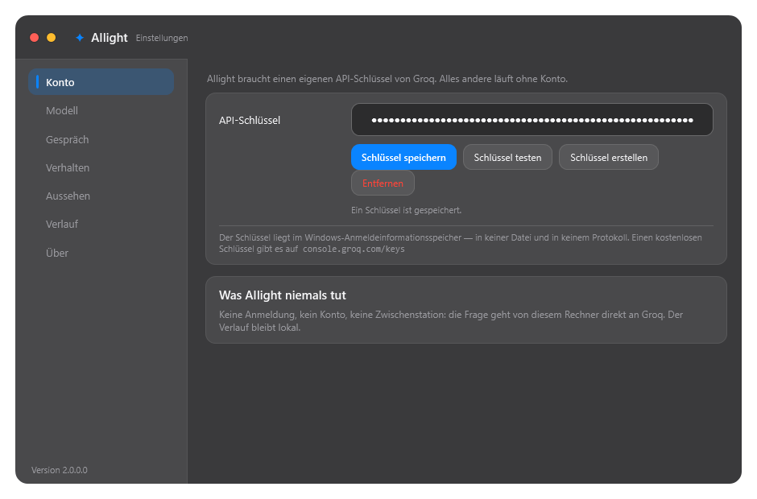
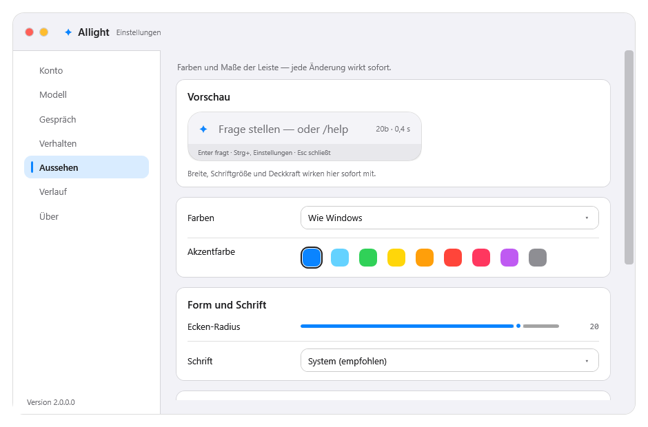

# AIlight

<p align="center">
  
</p>

<p align="center">
  <strong>AI launcher for Windows — press a hotkey, type a question, get a streaming answer.</strong>
</p>

<p align="center">
  <a href="https://github.com/rian2acc/AiLight/releases/latest"></a>
  <a href="https://github.com/rian2acc/AiLight/releases/latest"></a>
  <a href="https://github.com/rian2acc/AiLight/blob/main/LICENSE"></a>
  <a href="https://dotnet.microsoft.com/download/dotnet/8.0"></a>
  <a href="https://github.com/rian2acc/AiLight/actions"></a>
</p>

---

## ✨ Features

| Feature | Description |
|---------|-------------|
| **Global hotkey** | `Alt+Space` (customizable) — instant access from anywhere |
| **Streaming answers** | Response appears token-by-token via Groq API |
| **Smart suggestions** | Previous questions, commands, clipboard-aware — keyboard navigable |
| **Frameless settings** | 7 categories, live theme preview, no "OK" button needed |
| **Conversation memory** | Configurable context window, `/forget` to wipe |
| **History & stats** | Token usage, cost estimate, searchable, exportable |
| **System tray** | Single instance, autostart, zero background service |
| **macOS-inspired look** | Rounded corners, hairline borders, traffic-light window buttons, macOS accent palette |
| **Everything adjustable** | Accent color (9 macOS presets), corner radius, font, bar width/height/opacity, animations, thinking & footer switches |
| **Self-test built in** | `AIlight.exe --selftest` → 43 pixel-perfect assertions on the actual EXE |
| **Portable installer** | 46 MB Inno Setup bundle — includes .NET, no admin rights, per-user install |

---

## 📥 Installation

### Option A: Download installer (recommended)

1. Grab **`AIlightSetup.exe`** from the [latest release](https://github.com/rian2acc/AiLight/releases/latest) (~46 MB)
2. Run it — installs to `%LOCALAPPDATA%\AIlight`, adds Start Menu + autostart
3. On first launch, AIlight opens Settings → paste a **Groq API key** (free at [console.groq.com/keys](https://console.groq.com/keys))
4. Press **`Alt+Space`** and start asking

### Option B: Build from source

```powershell
# Prerequisites: .NET 8 SDK, Inno Setup 6
git clone https://github.com/rian2acc/AiLight.git
cd AiLight
powershell -ExecutionPolicy Bypass -File tools\build.ps1
# Output: dist\installer\AIlightSetup.exe
```

> The build script runs the 43-assertion self-test, publishes a trimmed single-file EXE, and packages the installer. Flags: `-SkipTest`, `-SkipInstaller`.

---

## ⌨️ Quick Reference

| Shortcut | Action |
|----------|--------|
| `Alt+Space` | Show/hide bar (configurable) |
| `Enter` | Send question / run selected suggestion |
| `Esc` | Cancel request, then close bar |
| `↑` `↓` / `PgUp` `PgDn` | Navigate suggestions |
| `Tab` | Fill input with selected suggestion |
| `Ctrl+↑` / `Ctrl+↓` | Browse previous questions |
| `Ctrl+C` | Copy last answer (normal copy in input) |
| `Ctrl+N` | New conversation (clear memory) |
| `Ctrl+H` | Open history |
| `Ctrl+,` | Open Settings |

**Commands** (type `/` in empty input):

| Command | Effect |
|---------|--------|
| `/new` | Start fresh conversation |
| `/clip` | Ask about clipboard contents |
| `/history [term]` | Search & open history |
| `/forget [term]` | Delete history (all if no term) |
| `/stats` | Show count, tokens, estimated cost |
| `/model [auto\|20b\|120b]` | Switch model |
| `/prompt` | View system prompt |
| `/conversation` | Show what gets sent to API |
| `/copy` | Copy last answer to clipboard |
| `/save` | Save last answer as `.md` file |
| `/settings` | Open Settings |
| `/help` | List all commands |
| `/quit` | Exit AIlight |

---

## 🎛️ Make it yours

The whole look is adjustable — every change applies instantly, no restart:

| Setting | Options |
|---------|---------|
| Accent | 9 macOS presets: Blue, Teal, Green, Yellow, Orange, Red, Pink, Purple, Graphite |
| Corner radius | 8–22 — the bar, cards, fields and rows scale together |
| Font | System (Segoe UI Variable), Segoe UI, Calibri, Arial |
| Bar | Width 420–1200, distance from top, font size 12–28, opacity 60–100 % |
| Motion | Fade-in and pulsing dot on/off |
| Answers | Auto-expand thinking steps, show/hide the model·tokens·cost footer |
| Behaviour | Hotkey, autostart, preload, hide on focus loss, logging |

## 🖼️ Screenshots

<p float="left">
  
  
</p>
<p float="left">
  
  
</p>

*More screenshots in [`docs/bilder/`](docs/bilder/) — generated by `AIlight.exe --shot docs\bilder`.*

---

## 🗂️ Data Locations

| Data | Path |
|------|------|
| Settings | `%APPDATA%\AIlight\settings.json` |
| History (JSONL) | `%APPDATA%\AIlight\history.jsonl` |
| Conversation context | `%APPDATA%\AIlight\conversation.json` |
| Last answer | `%APPDATA%\AIlight\last_answer.md` |
| Saved answers | `%USERPROFILE%\Documents\AIlight-Antworten` |
| Log (rolling, 4 files) | `%LOCALAPPDATA%\AIlight\logs\ailight.log` |
| API key | **Windows Credential Manager** → `AIlight:groq-api-key` |

> Uninstall keeps your settings, history & key. Reinstall = instant resume.

---

## 🛠️ Built-in Diagnostics

```powershell
AIlight.exe --selftest           # 43 assertions, exit code 0 = pass
AIlight.exe --smoke 4            # Bar, hotkey, tray, size, position
AIlight.exe --ask "Say: ok"      # Headless question
AIlight.exe --ask-ui "2+2?"      # Simulated UI interaction
AIlight.exe --shot docs\bilder   # Render all windows to PNG
AIlight.exe --show               # Show bar, keep open (Esc to close)
AIlight.exe --quit               # Stop running instance
AIlight.exe --report out.txt     # Write smoke/ask results to file
```

The self-test renders real windows and inspects **actual pixels** — e.g. slider fill must be accent-colored on the left only, selected suggestion row must show its accent bar at the expected coordinate.

---

## 🏗️ Architecture

```
src/AIlight/
  Program.cs           Entry: test modes → single instance → run
  App.cs               Lifecycle, hotkey, tray, windows, test modes
  MainWindow.*         The bar: input, suggestions, streaming markdown
  SettingsWindow.*     7 categories, live preview, frameless
  AppSettings.cs       Load/save JSON settings
  SelfTest.cs          43 pixel-level assertions
  Commands.cs          Slash-command registry
  Suggestions.cs       Suggestion rows under input
  Core/                Hotkey, single-instance, DPAPI key store, log, icons, paths
  Groq/                HTTP client, streaming, models, history
  Views/               Markdown renderer, themes (light/dark), screenshot helper
tools/                 build.ps1, test helpers, measurement tools
packaging/             ailight.iss (Inno Setup), ailight.ico
```

**Design choices:**

- **Single EXE**, no background service, no plugin system
- **Preloaded bar** built during idle → first hotkey ~6–40 ms
- **Direct Groq API** — no proxy, no telemetry
- **Self-test ships in the EXE** — tests exactly what users run
- **DPAPI-backed credential store** — key never touches disk
- **macOS-inspired design system** — one theme file drives colors, radii and type; every window follows it live

---

## 📊 Benchmarks (Release, this machine)

| Metric | Value |
|--------|-------|
| Bar appears (preloaded) | 6–40 ms |
| Bar appears (cold) | 0.5–0.8 s |
| First answer token | 0.4–0.6 s |
| Idle CPU | 0 % |
| Idle RAM | ~90 MB |
| Installer size | 46 MB (includes .NET 8) |
| Installed size | ~145 MB |

---

## ⚠️ Known Limitations

- **Groq only** — single provider, no model marketplace
- **Windows 10/11 x64** only
- Hotkey conflict detection (logs + UI warning if `Alt+Space` taken)
- Unsigned installer → SmartScreen "More info → Run anyway" on first launch
- Tested on author's Windows 10 account — not on clean VMs

---

## 🤝 Contributing

Issues and PRs welcome. Areas that'd love help:

- Code signing / Microsoft Store packaging
- Additional AI providers (OpenAI, Anthropic, local via Ollama)
- Linux/macOS via Avalonia or MAUI
- Unit tests for Groq client & history store
- Localization (currently German/English mixed)

```powershell
# Quick contributor loop
powershell tools\build.ps1 -SkipInstaller
AIlight.exe --selftest
```

---

## 📄 License

[MIT](LICENSE) — do whatever you want, just keep the notice.

---

## 🙏 Acknowledgments

- [Groq](https://groq.com/) for the blazing-fast inference API
- [.NET](https://dotnet.microsoft.com/) for single-file native publishing
- [Inno Setup](https://jrsoftware.org/isinfo.php) for the installer
- [Markdig](https://github.com/xoofx/markdig) for markdown rendering
